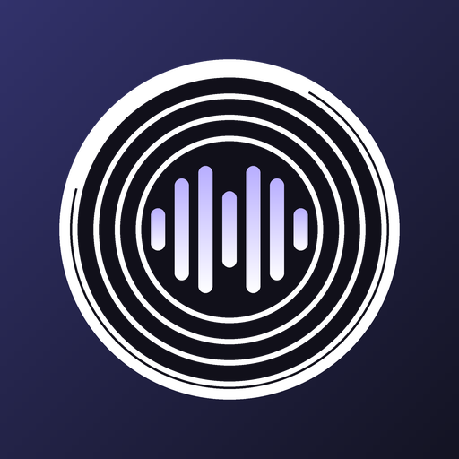

# Lossless



**Lossless** is an Android music player for people who care where the audio comes from. It plays YouTube Music, your own LastWave-style add-on, JioSaavn and self-hosted libraries, and — when a better copy of the track exists anywhere it can reach — it swaps to that copy instead of settling for the one it started with.

**Hi-Res Lossless, Lossless and Dolby Atmos are all supported** — whatever your add-on can deliver, the player will take: 24-bit / high-sample-rate FLAC as Hi-Res, 16-bit FLAC or ALAC bit-exact, and Dolby Atmos (E-AC-3 JOC) when your add-on supplies it and your device can decode it. Details in [Audio formats](#audio-formats).

It is an independent fork of [BitChord](https://github.com/kushagrasinghx/BitChord) with compatibility for the HTTP add-on protocol used by [LastWave-Native](https://github.com/Clash-Projects/LastWave-Native), built and maintained by **[daddyyour0786](https://github.com/daddyyour0786-dev)**.

> **Status:** independent fork, not affiliated with BitChord, LastWave, YouTube, Spotify, or any other service. It is a personal project shipping from this repository's own release feed; test on your own devices before relying on any one behaviour. See [Compatibility and limitations](#compatibility-and-limitations).

## Contents

- [What the app does](#what-the-app-does)
  - [Playback and sound](#playback-and-sound)
  - [Audio formats](#audio-formats)
  - [Where the audio comes from](#where-the-audio-comes-from)
  - [Library and downloads](#library-and-downloads)
  - [Lyrics](#lyrics)
  - [Finding music](#finding-music)
  - [Listen together](#listen-together)
  - [Other devices](#other-devices)
  - [Stats, sharing and integrations](#stats-sharing-and-integrations)
  - [Look and feel](#look-and-feel)
- [Defaults out of the box](#defaults-out-of-the-box)
- [Requirements](#requirements)
- [Build from source](#build-from-source)
- [Releases and in-app updates](#releases-and-in-app-updates)
- [Install and configure an add-on](#install-and-configure-an-add-on)
- [Where things live in Settings](#where-things-live-in-settings)
- [Modules that are switched off](#modules-that-are-switched-off)
- [Tests](#tests)
- [Compatibility and limitations](#compatibility-and-limitations)
- [Privacy and security](#privacy-and-security)
- [Contributing](#contributing)
- [License and acknowledgements](#license-and-acknowledgements)

## What the app does

Four tabs — **Home**, **Explore**, **Library**, **Search** — a full-screen player with lyrics, queue and a sleep timer, and a settings screen that is honest about what each switch does to the audio.

### Playback and sound

- **Bit-exact playback where a source has it.** A FLAC from your add-on is played as a FLAC, not transcoded on the way out.
- **Gapless quality upgrade.** Playback starts on whatever answers first, and if a better copy of the same track turns up mid-track it is swapped in with a short equal-power blend, at the same position, without a gap or a restart.
- **Add-on-first pre-cache.** Tracks queued ahead are resolved through your add-on *before* they play — and the bytes are cached, not just the URL. A skip, an Automix handover and a quality upgrade therefore open the add-on's stream rather than racing YouTube for it. YouTube is used only when the add-on does not have the track or is unreachable.
- **Quality ceilings per connection.** Separate rungs for Wi-Fi and mobile data: *Lossless* (your add-ons + JioSaavn), *High* (JioSaavn up to 320 kbps, YouTube fallback), *Medium* (YouTube Opus), *Low* (capped at ~64 kbps). Each rung says what it costs per hour.
- **Automix (beta).** Beat-and-structure-aware transitions instead of a fixed fade: the analyser times the blend from each track's tempo and energy. Off by default; it costs a background decode per track.
- **Crossfade** with an adjustable 0–12 s window, and **skip silence** for tracks with dead air at the edges.
- **7-band equalizer.** Sixteen presets (Flat, Bass Boost, Vocal, Rock, Hip-Hop, Jazz, Classical, Late Night…) plus a dynamic tone pad — tilt and contour — and a manual mode with sliders and balance. One engine at a time, so the two never fight.
- **Spatial audio** — stereo widening and cross-feed inside the player, for headphones.
- **Loudness normalization** using the track's own gain figure, with a separate rule for the phone's built-in speaker.
- **Dolby Atmos (E-AC-3) renditions**, opt-in, with a codec check so a device that cannot decode it is never offered it.
- **Output precision:** 16-bit PCM or 32-bit float at the AudioTrack boundary, **USB DAC preference** for external audio hardware, and a live Audio Pipeline readout that names the first stage altering the samples — so "bit-exact" is a claim you can check, not one you have to take.
- **Sleep timer**, shuffle, repeat, play-next-on-swipe, queue reordering and a queue history.
- **Playback speed**, and a *stats for nerds* view with the negotiated format, sample rate and decoder in use.
- **Smart audio alignment** — when one version of a track is a different edit from another, playback is aligned between them rather than restarted.

### Audio formats

What Lossless will play depends on what the source hands over — it does not cap the copy it accepts. The tiers, top down:

| Tier | What it is | Where it comes from |
| --- | --- | --- |
| **Hi-Res Lossless** | 24-bit / high-sample-rate FLAC, e.g. Tidal's `HI_RES_LOSSLESS` | Your add-on or module, when the catalogue holds a hi-res master. Recognised from the add-on's quality, format, bit-depth or sample-rate fields. |
| **Lossless** | 16-bit FLAC or ALAC, bit-exact | Your add-on or module, and your own local files. Played as it arrives — not transcoded on the way out. |
| **Dolby Atmos** | E-AC-3 with JOC (joint object coding), rendered by the device | Your add-on or module, **only if the provider actually offers an Atmos rendition** and the device reports a decoder for it — no add-on, no Atmos, and nothing is upmixed to fake it. Opt-in: *Settings → Audio quality → Dolby Atmos* (off by default). |
| **Lossy** | AAC, Opus, MP3, Vorbis, HE-AAC | JioSaavn (up to 320 kbps), YouTube Music's Opus ladder, and local files. |

- **Nothing is downgraded on arrival.** A lossless or hi-res copy is preferred over a lossy one for the same track, which is what [source matching](#where-the-audio-comes-from) and the [gapless quality upgrade](#playback-and-sound) exist to arrange.
- **The output is reported, not assumed.** *Stats for nerds* and the Audio Pipeline readout show the codec, bit depth, sample rate and any conversion the route applies — so "playing hi-res" is something you can check rather than take on faith. What the phone resamples or routes to a Bluetooth codec is the phone's business and is named there.
- **Lossless needs a lossless route.** If the output is a Bluetooth codec or a speaker path that cannot carry the format, the readout says so. 32-bit float output is available for the AudioTrack boundary, and a USB DAC can be preferred over the system route.
- **Local files** are played from disk in `mp3`, `m4a`, `mp4` (audio-only, including AC-4 / E-AC-3 / ALAC), `flac`, `ogg`, `opus`, `aac`, `webm`, and DSD in `dsf` / `dff`.

### Where the audio comes from

- **Your add-on** — any HTTP/HTTPS add-on speaking the LastWave protocol. It outranks every other source, and it is where Hi-Res Lossless, plain Lossless and Dolby Atmos come from: the player asks for the best copy the add-on has and takes it as-is. Its file type may be FLAC, ALAC, WAV, AIFF, AAC (including HE-AAC), MP3, MP4, Ogg, Opus, Vorbis or WebM.
- **Modules** — custom JavaScript module indexes you point at yourself, evaluated in an embedded engine.
- **JioSaavn** — catalogue fallback up to 320 kbps.
- **YouTube Music** — the always-available path, via the built-in client; also where metadata, artwork and search come from.
- **WebDAV and SMB** — music on your own server or NAS, browsed as a library with artwork read from the files themselves.
- **Local files** — a folder on the device.
- **Source matching** with a **track length tolerance** (default 5 s) that decides how different a candidate stream may be and still replace the one playing, plus per-source ordering, enable/disable switches and a test button.

### Library and downloads

- Sign in with a Google account to get your YouTube Music liked songs, playlists, albums, artists and history.
- **Import Spotify playlists** from a public link (or sign in) and have the tracks matched on YouTube Music.
- **Downloads** with their own quality setting — *Standard* (~128 kbps), *High* (best available), *Lossless* (keeps the bit-exact file when a source has one) — a *download over Wi-Fi only* guard, and an option to export compatible downloads to `Music/Lossless` so other apps can see them.
- A **cached songs** folder listing exactly what the streaming cache holds, per track, with partial entries marked and removable one at a time.
- Private library organisation: playlists, sort orders and view types kept per screen.

### Lyrics

- **Synced lyrics** from 15 providers, reorderable and individually disable-able — Apple-timed and syllable-synced hosts first, community databases and karaoke timings after, so a dead mirror never blocks a track that another host already has.
- Word-level highlighting, a **translation language** for the lines as they scroll, and blurring of the lines you are not on.
- **Share cards** — pick lines, lay them over the cover, and export as a card or a story.
- Embedded lyrics from your own local files are read directly, and the lyrics screen has its own provider picker so you can override the order for one track.

### Finding music

- **Home** with recent listens and suggestions, **Explore** with moods and genres (they fill in as listening history grows), and **Search** across artists, songs, albums, playlists and lyrics.
- **Radio and autoplay** that continue from the track you are on, with an option to never suggest a song already played this session.
- **Music-only preference:** for a music video, keep the video's details on screen but load the catalogue album audio instead.
- **Shareable links:** a shared track link opens the app and plays the track.
- **Filter non-music audio** out of results, and a per-language search setting.

### Listen together

- **Parties:** share a code and everyone plays the same music, in time, with controls locked to whoever is leading and each member's own queue stashed and restored.
- Works against the default party server or one you host yourself — the Go backend is in this repository under `backend/`.

### Other devices

- **Chromecast** — pick a receiver and the session follows it.
- **Android Auto** — the app declares an automotive media app, so it appears in the car's media UI.
- **Home-screen widgets** — a full player widget and a compact pill.
- **Bluetooth and USB audio** routing, with the negotiated codec and output shown in the player.

### Stats, sharing and integrations

- **Replay** — your listening, aggregated on the device: songs, artists, albums, genres and habits by month, with shareable summary cards. Nothing is uploaded anywhere.
- **Last.fm** and **ListenBrainz** scrobbling.
- **Discord rich presence** with configurable buttons (the current track, or this project).
- **Spotify Canvas** animated covers, with support for Apple Music and Tidal animated artwork as alternatives, plus a per-connection switch for playing them on mobile data.
- **Backup:** export all settings and library data to a file and import it on another device.

### Look and feel

- Material 3, one rendering path (Android 12+), light/dark/system themes.
- **Animated cover art** with full-bleed artwork, a dynamic mesh gradient (with a legacy variant for lower-end GPUs), and reduce-animation and reduce-blur switches.
- A player that stays out of the way when you want it to: hide the volume bar, hide the status bar, hide the song status line.
- Choose the launcher icon style, and an optional high-performance mode with an explicit refresh-rate cap.
- **In-app updates** — the app checks this repository's release feed and offers the new build with its release notes.

## Defaults out of the box

A fresh install is bit-exact and unsurprising:

| Setting | Default |
| --- | --- |
| Audio quality | Lossless (Wi-Fi and mobile data) |
| Dolby Atmos | off |
| Loudness normalization | off |
| Disable on Phone Speaker | off |
| Crossfade | 5 seconds |
| Automix | off (beta) |
| Equalizer | off (Flat) |
| Output precision | 16-bit PCM |
| Theme | System |
| Track length tolerance | 5 seconds |
| Play animated cover over cellular | on |
| Don't repeat songs in current session | on |
| Prefer music-only version | on |
| Download quality | Lossless |
| Download over Wi-Fi only | on |
| Automix performance | Balanced |
| Song cache limit | 512 MB |

Everything here is a switch you can flip; nothing above is a lock-in.

## Requirements

To build locally:

- Android Studio, JDK 17.
- Android SDK Platform 37 (`compileSdk = 37`), build tools 35.0.0.
- Android NDK 27.0.12077973 and CMake 3.22.1.
- Git.

The app **requires Android 12 (API 31) or newer and will not install below it** (`minSdk = 31`, `targetSdk = 36`). That is deliberate: the UI leans on API 31 platform features — RenderEffect blur, frame-rate control, the platform widget radius — so there is exactly one code path to keep fast instead of a modern one and a fallback.

## Build from source

```bash
git clone https://github.com/daddyyour0786-dev/Lossless.git
cd Lossless
./gradlew :app:assembleProdDebug
```

On Windows PowerShell:

```powershell
.\gradlew.bat :app:assembleProdDebug
```

APKs land in `app/build/outputs/apk/prod/debug/`. The application ID is `com.daddyyour0786.lossless`; a `.dev` variant is built alongside it for side-by-side installs.

A signed release build needs `keystore.properties` in the project root (see `keystore.properties.example`):

```bash
./gradlew :app:assembleProdRelease \
  -PversionName=0.1.2 -PversionCode=102
```

`app` is the only Android module the build pulls in — see [Modules that are switched off](#modules-that-are-switched-off).

## Releases and in-app updates

`.github/workflows/android-release.yml` builds a signed release APK on demand and publishes it here as a GitHub Release:

- The version auto-increments from the newest release tag (`v0.1.1` → `0.1.2`); pass a version to cut something else.
- `versionCode` is derived as `major*10000 + minor*100 + patch`, so it always climbs.
- Assets are named `Lossless-v<version>.apk` (universal) plus one per ABI; the in-app updater prefers the universal build and falls back to the split matching the device.
- **Release notes are generated from the commits** between the previous release's tag and the commit being built, so the release page — and the in-app update prompt, which renders the same body — describes what actually changed.

Publishing is what makes the in-app prompt fire: the app reads `releases/latest`, which only returns published releases.

## Install and configure an add-on

1. Install a build on your Android device.
2. Open **Settings → Audio quality → Sources → Add an addon**.
3. Enter your add-on URL. It may accept its root URL or its `manifest.json` URL. Test the URL, then save.
4. Leave it enabled. To have it answer first, choose **Lossless** for the connection you are on — that rung is the one that asks your add-ons and JioSaavn before YouTube, and the pre-cache keeps queued tracks on it.
5. Add-ons are also searchable directly from the **Addons** source in Search.
6. **Automix** is optional: **Settings → Playback → Automix [BETA]**.

**Keep add-on URLs private.** A URL path may contain an access token. Do not post private URLs, tokens or provider credentials in issues, screenshots, logs or pull requests. No add-on URL is embedded in this repository or in the published APK — you configure your own after installing.

## Where things live in Settings

| I want to change… | Go to |
| --- | --- |
| Which sources are asked, and in what order | Audio quality → Sources |
| Bitrate ceiling per connection | Audio quality → On Wi-Fi / On mobile data |
| Bit-exact vs 32-bit float output, USB DAC | Playback → Output precision / Prefer USB DAC |
| Crossfade, Automix, skip silence, spatial audio | Playback |
| Equalizer and tone pad | Playback → Equalizer |
| Download quality, Wi-Fi-only downloads, export to `Music/Lossless` | Downloads |
| Song cache limit, clear caches, cached songs folder | Storage |
| Theme, animated cover, full-screen art, blur and animation | Appearance |
| Lyrics providers, translation, blur | Lyrics (in the player's lyrics sheet and Settings) |
| Local folder, WebDAV, SMB, Spotify import | Library / Sources |
| Last.fm, ListenBrainz, Discord, Spotify, Listen together | Account & integrations |
| Replay, backup export/import | Your data |
| Refresh rate, high-performance mode, icon, updates | Miscellaneous / Performance / Appearance |

## Modules that are switched off

`settings.gradle.kts` includes `:app` alone. The `tv/` and `wearos/` modules are still in the repository but are not built by this release and have not been kept in step with the phone app. Treat them as parked source rather than shipping apps.

- **Wear OS** — the phone no longer carries a watch APK, so *Settings → Lossless for Wear OS* does not appear at all (the section keys off the bundled APK, see `WatchInstaller.available`), and nothing is installed on a watch.
- **TV** — no TV APK is produced, and the phone app has no TV-only behaviour.

To bring either back: uncomment its `include(...)` in `settings.gradle.kts`, restore the watch-bundling task in `app/build.gradle.kts`, and add the module back to the GitHub Actions build.

## Tests

Unit tests run on the JVM:

```bash
./gradlew :app:testProdDebugUnitTest
```

The add-on protocol regression suite on its own:

```bash
./gradlew :app:testProdDebugUnitTest \
  --tests com.music.bitchord.LastWaveCompatibilityTest \
  --tests com.music.bitchord.AddonSourceTest
```

Automated tests do not prove that audio plays on a particular phone. When reporting results, separate what the tests showed from what you heard, and name the device, Android version, source and steps.

## Compatibility and limitations

- Implements the LastWave HTTP request signature and streaming intent for token-style `/a/{token}` URLs, along with common LastWave search and stream JSON shapes.
- Supports HTTP/HTTPS add-ons that return a playable HTTP(S) stream URL.
- Does **not** support encrypted `.lwp` packages, private provider keys, DRM, or add-ons that return only inline DASH data.
- Lossless playback depends on the add-on, the connection and the device's codecs. Atmos needs a device that can decode E-AC-3.
- Automix is beta and inherited from upstream. For ordinary catalogue results it may analyse a matching YouTube rendition even when playback uses an add-on; tracks picked straight from Addons search are not sent to YouTube for analysis and may fall back to a plain crossfade.
- Matching, lossless playback, transitions, downloads, Android Auto and Cast should each be checked on real hardware before being called verified.
- The interface is English only.
- This fork does not offer BitChord releases as Lossless updates and does not report the fork's open-app presence count to BitChord. Other inherited optional integrations and third-party services still exist in the source.
- Third-party services used here (JioSaavn, lyrics hosts, Last.fm, ListenBrainz, Discord, Spotify, Google Cast) are reached on your connection with your credentials or none, and are subject to their own terms.

Use the app, add-ons and third-party services only in ways permitted by their terms and applicable law.

## Privacy and security

- Listening statistics and the song cache stay on the device. Nothing in Replay is uploaded.
- Credentials live in the Android keystore-backed storage; nothing sensitive is written to the repository or to backups by default.
- Do not commit API keys, signing keys, passwords, access tokens, private add-on URLs or local configuration files.
- Treat logs and screenshots as potentially sensitive; redact account details, tokens and personal information before sharing them.
- Report suspected vulnerabilities privately. See [SECURITY.md](SECURITY.md).

## Contributing

Bug reports, focused fixes, documentation improvements and tested compatibility reports are welcome. Please read [CONTRIBUTING.md](CONTRIBUTING.md) and follow the project's [Code of Conduct](CODE_OF_CONDUCT.md).

## License and acknowledgements

This project is distributed under the **GNU General Public License v3.0 (GPL-3.0)**. See [LICENSE](LICENSE) for the full text and [THIRD_PARTY_NOTICES.md](THIRD_PARTY_NOTICES.md) for upstream and third-party attribution.

- **Lossless** — maintained by [daddyyour0786](https://github.com/daddyyour0786-dev).
- **BitChord** — the upstream player, by [kushagrasinghx](https://github.com/kushagrasinghx). Its notices and licence must be preserved.
- **LastWave** — the HTTP add-on protocol, from [LastWave-Native](https://github.com/Clash-Projects/LastWave-Native).

Lossless is an independent project. Product names and trademarks belong to their respective owners.
